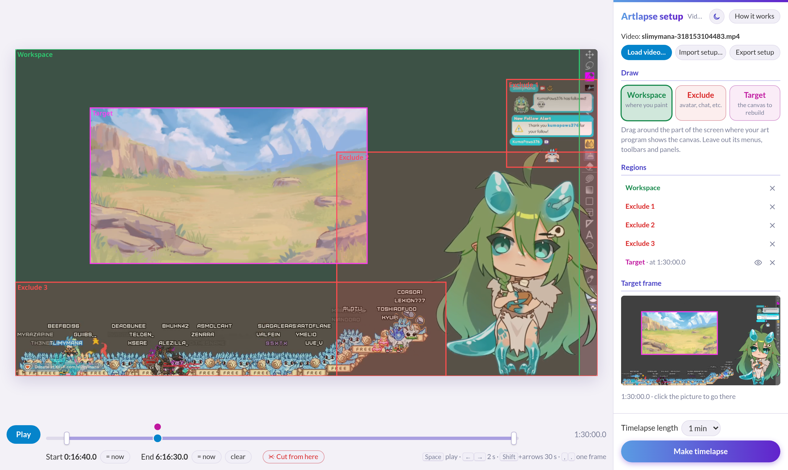
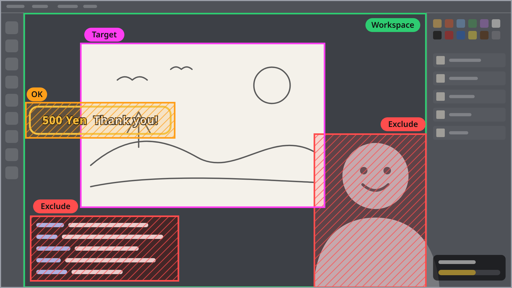

<div align="center">

# Artlapse

Turn the recording of your painting stream into a timelapse of the painting.

Any art program · any stream layout · zoom, pan, rotate and flip · runs in your browser, nothing uploaded

https://github.com/user-attachments/assets/aa40c0b5-fddf-482a-9894-c7fc32e7cd53

<sub>Illustration and stream by <a href="https://x.com/SlimyMana">SlimyMana</a>. Left: six hours of a stream. Right: the painting Artlapse rebuilt from it, the timelapse it made. <a href="docs/media/stream-and-painting.mp4">Watch the video</a>. </sub>

</div>
<br/>

## Why

If your art program recorded the canvas while you worked, making a timelapse is easy. If all you have is the stream recording, it isn't: the canvas moves every time you zoom, pan, rotate or flip it, your avatar and chat sit on top of it, and sometimes the screen shows something else entirely. Sped up, that's a minute of shaking, spinning screen.

Artlapse finds the canvas in every frame and rebuilds it as one steady picture. The timelapse shows that picture filling in, from the first stroke to the last.

## What it does

- **Follows the canvas through anything you do to it**: zooming, panning, rotating, flipping, at any size on screen.
- **Leaves out what isn't the painting**: your avatar, the chat and other overlays you mark once; alerts and the cursor by themselves, since they don't stay still long enough to be painted in.
- **Skips what isn't the canvas**: break scenes, references, other documents and other programs are noticed and left out, so you don't have to edit the recording first.
- **Keeps the detail of your close-ups**: the painting is rebuilt at up to 2048 pixels on its long side, sharper than the stream ever showed the whole canvas, because the details come from the moments you zoomed in on them.
- **Paces the timelapse by painting**: busy stretches get more of it than quiet ones, and it ends holding on the finished piece. You choose the length, from 15 seconds to 5 minutes.
- **Stays on your computer**: the website does all the work in your browser, on your graphics card (or, where the browser can't use it, on the processor). The recording is read where it is and never uploaded.

## Make your timelapse

You need the recording of the stream (an OBS recording, or a VOD) and a recent browser. Chrome or Edge on a computer work best: they use the graphics card through WebGPU (on Linux that can need setup). Without WebGPU the website makes the timelapse on the processor instead, and says so: it comes out the same but takes about four times as long on a fast desktop, and longer on a slower one.

1. Open [artlapse.tintan.do](https://artlapse.tintan.do) and press **Load video**.
2. Draw three kinds of box on the video (see below). A short tour shows you around the first time, and **How it works** explains each box with an example.
3. Choose the length of the timelapse and press **Make timelapse**. Keep the tab open while it works.
4. Press **Play the timelapse** to watch it, then **Save the video** and **Save the painting**. Save them before you close the tab: nothing is kept afterwards.

Your boxes are remembered in this browser for that recording, and **Export setup** saves them to a file: **Import setup** on your next stream with the same layout and you only have to draw the Target again.



## Setting it up



- **Workspace** (green): the part of the screen where your art program shows the canvas. Leave out its menus, toolbars and panels: anything inside the Workspace that stays still long enough, like a toolbar icon, can end up painted in.
- **Exclude** (red): things on top of the canvas that stay there, like your avatar, the chat or a webcam. Whatever is under an exclusion is never painted in. Draw as many as you need. Brief things, alerts and the cursor, need no box.
- **Target** (pink): the part of the canvas to rebuild, usually the whole document. The timelapse shows exactly this box, the way it looks on the frame you draw it on. Pick a frame where the canvas is upright and not flipped and all of it is on screen; near the end of the stream often works, because the painting is all there and its edges are easy to see. Draw it around the document itself, not around the program's background: what is in the box but outside the document shows up as a border.

**Start**, **End** and **cuts** on the timeline are optional: breaks and other scenes are left out by themselves, so they only make it faster. One is worth setting: if your stream ends with an animation over the canvas, like a raid or a parade of viewer avatars, set the End before it.

The page tells you, at the top of the sidebar, about anything that would spoil the result, such as a Target outside the Workspace or mostly under exclusions, with a button to show you where.

## How long it takes

The time grows with the length of the stream. A 36-minute stream took 7 minutes on the website, on a desktop with an NVIDIA RTX 3080. A six-hour stream took 32 minutes with the version you run yourself (below), on the same computer. A slower graphics card takes longer. Without the graphics card, on the processor, the first five minutes of the same stream took 4 minutes instead of 1, on a 10-core Intel i5-13400F.

Made again after a change, it redoes only what the change affects: a new length only remakes the video, which takes under a minute.

## Run it yourself

The website is the same program as this repository, built for the browser. You can also run it on your own computer, which is faster on long streams, can use an NVIDIA graphics card through CUDA, and has tools for when a result goes wrong. You need [uv](https://docs.astral.sh/uv/) and [FFmpeg](https://ffmpeg.org/):

```bash
git clone https://github.com/tintando/artlapse
cd artlapse
uv sync                               # or: uv sync --extra gpu, with an NVIDIA graphics card
uv run artlapse setup work/my-stream  # opens the same setup page in your browser
```

**Make timelapse** on that page writes the timelapse to `work/my-stream/timelapse.mp4` and the painting to `work/my-stream/final.png`. The command line can do everything the page does and more: [docs/command-line.md](docs/command-line.md).

To serve the website version on your own computer instead (Node.js 22 or later): `cd web && npm install && npm run dev`, then open the address it prints.

## When something looks wrong

Most problems come from the boxes, and are fixed by drawing them again and making the timelapse again:

- **Bits of the program's interface on the painting**, like toolbar icons: the Workspace takes in part of the interface. Move its edge in.
- **Your avatar, a chat line or a ticker painted in**: something that stays on screen has no Exclude box over it.
- **A border of program background around the painting**: the Target is larger than the document.
- **Something painted over the finished piece at the end**: an end-of-stream animation. Set the End before it.

If the painting jumps or smears for a stretch, Artlapse lost track of where the canvas was. The version you run yourself can find where that happened: [docs/troubleshooting.md](docs/troubleshooting.md).

## Scope and known gaps

**A break scene made from a blurred copy of your canvas can be painted in.** It looks too much like the canvas. Cut that stretch out with a cut on the timeline.

**Fading a sketch layer can lose the canvas for a minute.** Right after the sketch is faded, until the lineart is far enough along, there is little left that Artlapse recognises, and that stretch of painting is skipped. It shows as the lineart appearing a little later than it was drawn.

**Areas shown only in brief glimpses may not be painted in.** A change has to stay on screen for 8 seconds to count, which is what keeps the cursor and alerts out. A corner you only ever saw in passing keeps an earlier state.

**A drawing continued over several streams** is joined into one timelapse only by the version you run yourself ([docs/command-line.md](docs/command-line.md#a-drawing-over-several-streams)).

## Documentation

- [How it works](docs/how-it-works.md): how the canvas is found in each frame and rebuilt.
- [Command line](docs/command-line.md): running it yourself, every command and setting, the GPU, the sample cache.
- [Troubleshooting](docs/troubleshooting.md): finding where a timelapse went wrong.
- [Development](docs/development.md): the tests, and how the figures and media are made.
- [The browser version](web/README.md): how the website runs the same engine on WebGPU, and how it compares.

## Acknowledgements

The stream and the illustration in the video and the screenshots are by [SlimyMana](https://x.com/SlimyMana).

Artlapse is built on [OpenCV](https://opencv.org/) (its SIFT features find the canvas; the website's are a WebGPU port of them), [NumPy](https://numpy.org/) and [FFmpeg](https://ffmpeg.org/); on the GPU, [CuPy](https://cupy.dev/) and [COLMAP](https://colmap.github.io/)'s SiftGPU. The website reads and writes video with [Mediabunny](https://mediabunny.dev/) over the browser's WebCodecs.
